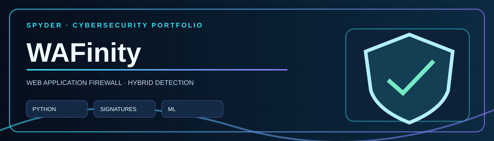

# WAFinity — Web Application Firewall Prototype

Experimental Flask application with a signature-based request classifier and an optional machine-learning decision path for obfuscated requests.

## Project components

- Flask HTTP routes for a dashboard and request inspection.
- Signature checker and preprocessing utilities.
- Machine-learning helper module and serialized model artifact.
- Static HTML/CSS/JavaScript dashboard.

## Run (development only)

```bash
python -m pip install -r requirements.txt
python app.py
```

Use a local isolated environment. Some dependencies and serialized model versions may require adjustment.

## Security and accuracy notes

- This is a **prototype**, not an independently benchmarked or production-ready web application firewall.
- Any detection result should be validated against a controlled evaluation dataset before making performance claims.
- Only test systems for which you have authorization.
- Previous commits include generated `.pyc` files and request logs. Current source no longer writes raw request payloads to the demonstration log; historical copies remain in Git history.
- The `logs/` directory is created at startup when needed.

## Validation status

Source and dependencies have been reviewed, but no full integration/regression test has been completed in this audit.

## Maintainer

Abhinav Saini · GitHub: spyderabhi

## License

No root LICENSE was identified; verify appropriate terms before redistribution.
